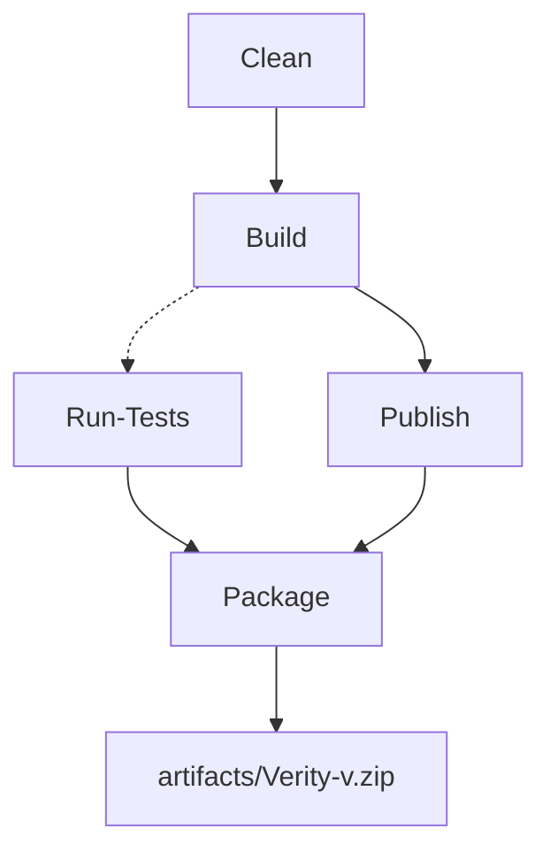

# Building from Source


## Table of Contents
1. [Development Environment Setup](#development-environment-setup)
2. [Build System Overview](#build-system-overview)
3. [Build Targets and Workflow](#build-targets-and-workflow)
4. [Versioning Configuration](#versioning-configuration)
5. [Publishing and Packaging](#publishing-and-packaging)
6. [Running the Compiled Application](#running-the-compiled-application)
7. [Common Build Issues and Troubleshooting](#common-build-issues-and-troubleshooting)
8. [Customizing the Build Process](#customizing-the-build-process)

## Development Environment Setup

To build Verity from source, you must first set up a development environment with the required tools and dependencies. Verity targets .NET 10 (`net10.0`), so the .NET 10 SDK (10.0.x) is required. The build uses Cake 6.3 (`cake.tool` 6.3.0 in `.config/dotnet-tools.json`).

### Installing .NET 10 SDK

1. Download the .NET 10 SDK from the official Microsoft website: https://dotnet.microsoft.com/download/dotnet/10.0
2. Run the installer and follow the on-screen instructions.
3. Verify the installation by opening a terminal and running:
   
```bash
   dotnet --version
   ```

   This should output a version number starting with `10.0`.

### Cloning the Repository

After installing the SDK, clone the Verity repository to your local machine:


```bash
git clone https://github.com/your-username/Verity.git
cd Verity
```


Ensure that Git is installed and available in your system PATH.

**Section sources**
- [README.md](../../README.md)

## Build System Overview

Verity uses the Cake (C# Make) build automation system to manage its build process. Cake provides a cross-platform way to define and execute build tasks using C# code.

### Cross-Platform Build Scripts

The project includes two build scripts for different operating systems:

- `build.ps1`: PowerShell script for Windows
- `build.sh`: Bash script for Unix-based systems (Linux, macOS)

Both scripts perform the same core functions:
1. Set environment variables to optimize .NET CLI behavior
2. Restore Cake tools using `dotnet tool restore`
3. Execute the Cake build script with `dotnet cake`


```powershell
# build.ps1
$ErrorActionPreference = 'Stop'
Set-Location -LiteralPath $PSScriptRoot
$env:DOTNET_SKIP_FIRST_TIME_EXPERIENCE = '1'
$env:DOTNET_CLI_TELEMETRY_OPTOUT = '1'
$env:DOTNET_NOLOGO = '1'
dotnet tool restore
dotnet cake @args
```


```bash
# build.sh
#!/usr/bin/env bash
set -euox pipefail
cd "$(dirname "${BASH_SOURCE[0]}")"
export DOTNET_SKIP_FIRST_TIME_EXPERIENCE=1
export DOTNET_CLI_TELEMETRY_OPTOUT=1
export DOTNET_NOLOGO=1
dotnet tool restore
dotnet cake "$@"
```


The environment variables disable unnecessary .NET CLI features that could interfere with automated builds:
- `DOTNET_SKIP_FIRST_TIME_EXPERIENCE`: Skips first-run setup
- `DOTNET_CLI_TELEMETRY_OPTOUT`: Disables telemetry collection
- `DOTNET_NOLOGO`: Suppresses the .NET logo in output

**Section sources**
- [build.ps1](../../build.ps1)
- [build.sh](../../build.sh)

## Build Targets and Workflow

The build process is defined in `build.cake`, which specifies a series of tasks that can be executed in sequence. The default target is "Default", which simply runs "Package" (CI passes `--target=Package` explicitly).

### Available Build Targets

| Target | Description | Dependencies |
|--------|-------------|--------------|
| Clean | Removes build artifacts and temporary files | None |
| Build | Compiles the source code | Clean |
| Run-Tests | End-to-end smoke test of `Verity.exe` (create/verify per algorithm, then verify after introducing errors) in temporary directories | None (uses the Build output in `Verity/bin/<configuration>/net10.0`) |
| Publish | Publishes a self-contained single-file `win-x64` executable | Build |
| Package | Creates distributable package | Publish, Run-Tests |

### Build Execution

To run the build process, execute the appropriate script for your platform:

**Windows:**

```powershell
.\build.ps1 --target=Package
```


**Unix-based systems:**

```bash
./build.sh --target=Package
```


To run a specific target, pass it as an argument:

```bash
./build.sh --target=Build
```


The build workflow follows this sequence:
1. Clean previous build artifacts
2. Compile the Verity and Verity.Tests projects
3. Publish the self-contained single-file executable
4. Run the end-to-end smoke tests
5. Package the executable into a ZIP file





**Diagram sources**
- [build.cake](../../build.cake)

**Section sources**
- [build.cake](../../build.cake)

## Versioning Configuration

Verity uses Nerdbank.GitVersioning (NBGV) for automated version management. This system generates version numbers based on Git repository metadata, ensuring consistent and meaningful versioning.

### version.json Configuration

The versioning strategy is defined in `version.json`:


```json
{
  "$schema": "https://raw.githubusercontent.com/dotnet/Nerdbank.GitVersioning/main/src/NerdBank.GitVersioning/version.schema.json",
  "version": "1.2",
  "assemblyVersion": {
    "precision": "revision"
  },
  "publicReleaseRefSpec": [
    "^refs/heads/main$",
    "^refs/heads/v\\d+\\.\\d+$"
  ],
  "cloudBuild": {
    "buildNumber": {
      "enabled": true
    }
  }
}
```


Key configuration elements:
- **version**: Base version number (a pre-release suffix such as `-alpha` may be appended)
- **assemblyVersion.precision**: Sets assembly version precision to revision level
- **publicReleaseRefSpec**: Regular expressions defining branches that produce public releases
- **cloudBuild.buildNumber.enabled**: Enables build number integration with CI/CD systems

During the build process, the Package task retrieves version information using the `nbgv get-version --format json` command and incorporates it into the package filename.

**Section sources**
- [version.json](../../version.json)
- [build.cake](../../build.cake)

## Publishing and Packaging

Verity is published as a self-contained, single-file Windows x64 executable (`Verity.exe`, about 39 MB). The .NET runtime is bundled, so no separate .NET installation is needed on target systems. On first run the executable extracts its contents to `%TEMP%\.net\Verity`.

Native AOT and trimming are **not** used: AlphaVSS loads its C++/CLI platform assembly (`AlphaVSS.x64.dll`) at runtime via `AssemblyLoadContext.LoadFromAssemblyPath`, which Native AOT cannot do. `IncludeAllContentForSelfExtract` is required so that this assembly exists as a real file next to `AlphaVSS.Common.dll`.

### Publish Process

Publishing is performed by the "Publish" task in the Cake script:


```csharp
Task("Publish")
    .IsDependentOn("Build")
    .Does(() => {
    DotNetPublish("./Verity/Verity.csproj", new DotNetPublishSettings {
        Configuration = configuration,
        OutputDirectory = publishDir,
        Runtime = "win-x64",
        SelfContained = true,
        PublishSingleFile = true,
        ArgumentCustomization = args => args
            .Append("/p:IncludeAllContentForSelfExtract=true")
            .Append("/p:EnableCompressionInSingleFile=true")
    });
    Information("Published to: {0}", publishDir);
});
```


Key publish settings:
- **Runtime = "win-x64"**: Target runtime identifier (VSS is Windows-only)
- **SelfContained = true**: Bundles the .NET runtime
- **PublishSingleFile = true**: Produces a single `Verity.exe`
- **IncludeAllContentForSelfExtract=true**: Extracts all bundled content (including the AlphaVSS C++/CLI assembly) to disk on first run
- **EnableCompressionInSingleFile=true**: Compresses the bundled content

The output is written to `Verity/bin/<configuration>/net10.0/win-x64/publish`.

### Cross-Platform Packaging

The "Package" task creates a ZIP archive containing the compiled executable:

1. Retrieves version information from NBGV
2. Determines the current Git branch
3. Constructs a package filename with version and branch information
4. Zips the published files into the artifacts directory

The resulting package follows this naming convention:

```
Verity-v<version>.zip
Verity-v<version>-<branch>.zip  # For non-main branches
```


**Section sources**
- [build.cake](../../build.cake)
- [build.cake](../../build.cake)

## Running the Compiled Application

After a successful build, the compiled Verity executable can be found in the `artifacts` directory as a ZIP file. To use the application:

1. Extract the ZIP file:
   
```bash
   unzip artifacts/Verity-v*.zip -d verity-app
   ```


2. Run the executable:
   
```bash
   verity-app\Verity.exe --help
   ```


The application supports three main commands:
- **verify**: Verify file integrity against a checksum manifest
- **create**: Create a new checksum manifest from a directory
- **add**: Add new files to an existing manifest

Example usage:

```bash
# Create a manifest
Verity.exe create backup.sha256 --root D:\backup --include "*.txt;*.pdf"

# Verify a manifest
Verity.exe verify backup.sha256 --root D:\backup
```


**Section sources**
- [README.md](../../README.md)
- [Program.cs](../../Verity/Program.cs)

## Common Build Issues and Troubleshooting

### Missing .NET 10 SDK

**Symptom**: `dotnet` command not found or wrong version reported.

**Solution**: Install the .NET 10 SDK (10.0.x) from the official website and ensure it's in your system PATH.

### Cake Tool Not Restored

**Symptom**: `dotnet cake` command fails with "command not found" error.

**Solution**: Ensure `dotnet tool restore` completes successfully. If it fails, try:

```bash
dotnet new tool-manifest
dotnet tool restore
```


### Version Retrieval Failure

**Symptom**: Build fails when retrieving version information with `nbgv`.

**Solution**: Install the Nerdbank.GitVersioning tool globally:

```bash
dotnet tool install -g nbgv
```


### Platform-Specific Compilation

**Symptom**: Need to build for a platform other than Windows x64.

**Solution**: Verity depends on Windows VSS (AlphaVSS), so only Windows runtime identifiers are meaningful. Change `Runtime` in the Publish task (e.g. `win-arm64`) and update the `publishDir` variable in `build.cake` accordingly.

### Test Failures

**Symptom**: Run-Tests task fails.

**Solution**: Run tests directly using the .NET CLI for better diagnostics:

```bash
dotnet test Verity.Tests/Verity.Tests.csproj --configuration Release
```


**Section sources**
- [build.ps1](../../build.ps1)
- [build.sh](../../build.sh)
- [build.cake](../../build.cake)

## Customizing the Build Process

The build process can be customized for different deployment scenarios by modifying the Cake script or using command-line arguments.

### Configuration Options

The build script accepts two main arguments:
- **target**: Specifies which task to run (e.g., `--target=Build`)
- **configuration**: Sets the build configuration (Debug or Release, default: Release)

### Modifying Build Targets

To add a new build target, edit `build.cake` and define a new task:


```csharp
Task("Custom-Target")
    .IsDependentOn("Build")
    .Does(() => {
    // Custom build logic here
    Information("Running custom build steps...");
});
```


### Cross-Platform Builds

To publish for additional Windows runtime identifiers, extend the Publish task:


```csharp
// Create a publish task for each Windows runtime identifier
foreach (var rid in new[] { "win-x64", "win-arm64" }) {
    Task($"Publish-{rid}")
        .IsDependentOn("Build")
        .Does(() => {
        DotNetPublish("./Verity/Verity.csproj", new DotNetPublishSettings {
            Configuration = configuration,
            OutputDirectory = Directory("./Verity/bin") + Directory(configuration)
                + Directory("net10.0") + Directory(rid) + Directory("publish"),
            Runtime = rid,
            SelfContained = true,
            PublishSingleFile = true,
            ArgumentCustomization = args => args
                .Append("/p:IncludeAllContentForSelfExtract=true")
                .Append("/p:EnableCompressionInSingleFile=true")
        });
    });
}
```


### Continuous Integration Integration

The build script is designed to work with CI/CD systems. The `cloudBuild.buildNumber.enabled` setting in `version.json` ensures that build numbers are properly set in CI environments like GitHub Actions.

**Section sources**
- [build.cake](../../build.cake)
- [version.json](../../version.json)

**Referenced Files in This Document**   
- [README.md](../../README.md)
- [build.ps1](../../build.ps1)
- [build.sh](../../build.sh)
- [build.cake](../../build.cake)
- [version.json](../../version.json)
- [Program.cs](../../Verity/Program.cs)
- [Models.cs](../../Verity/Models.cs)