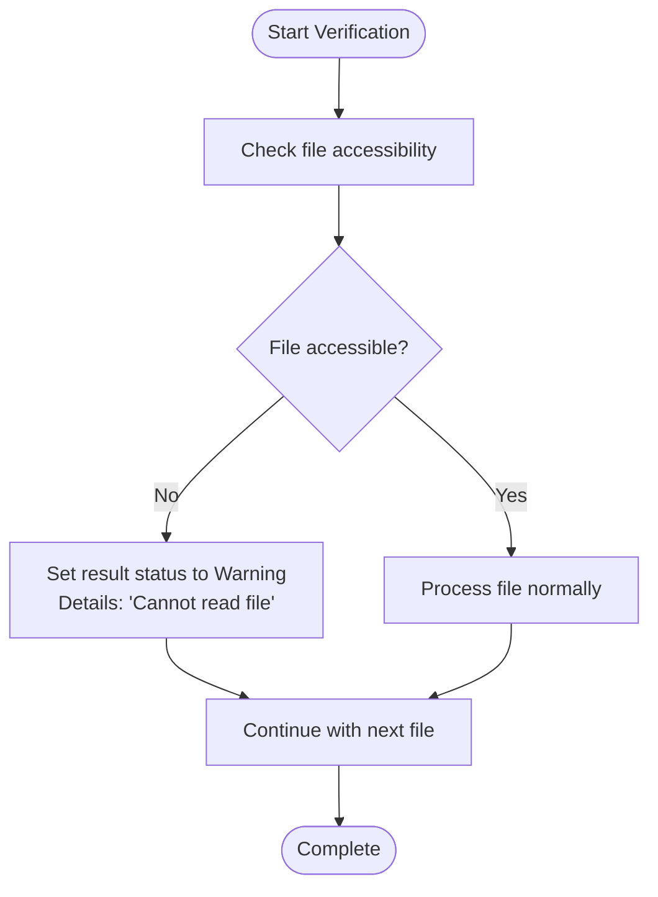
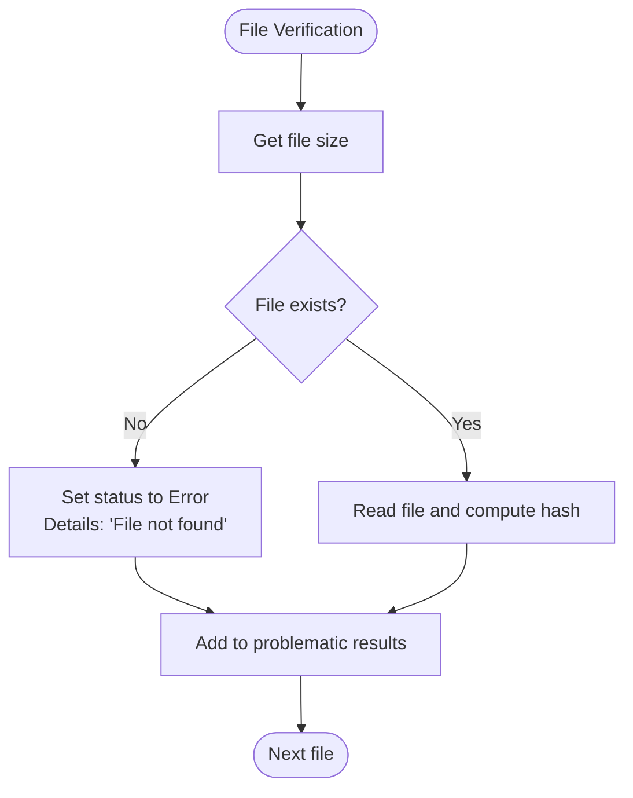
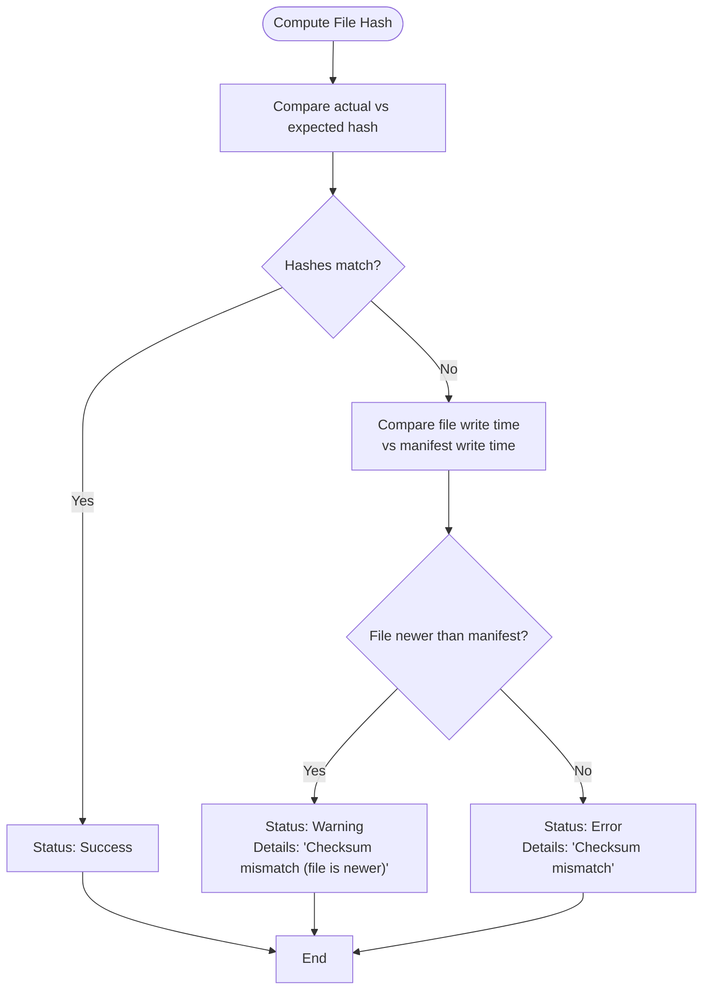
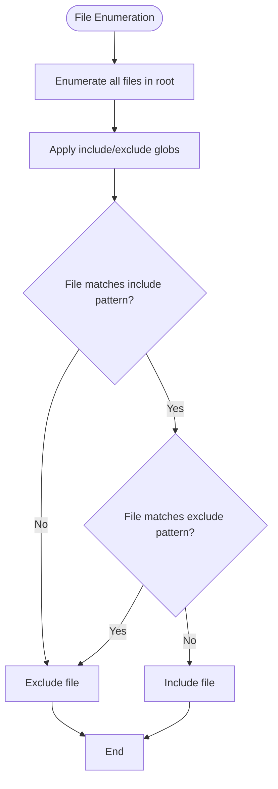
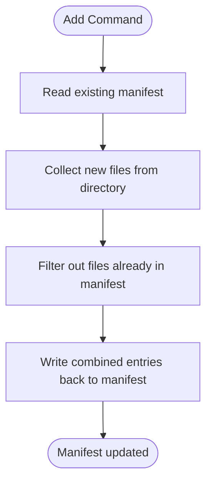
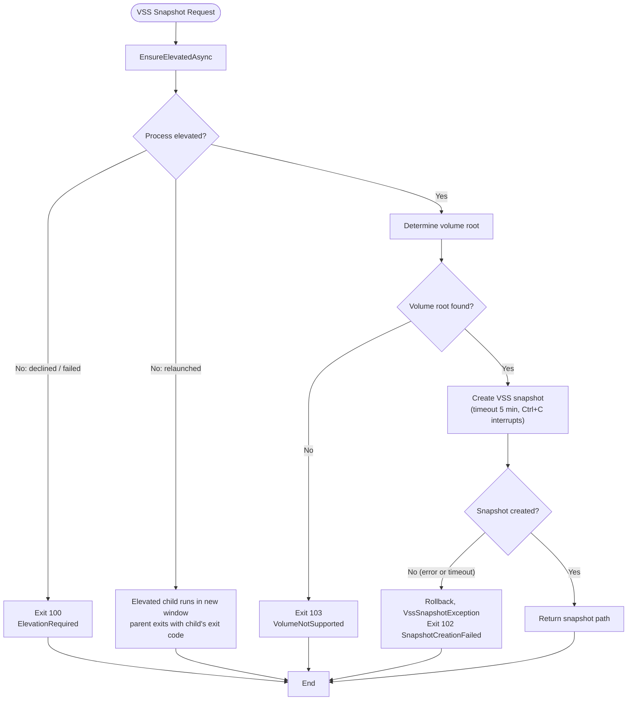

# Troubleshooting Guide


## Update Summary
**Changes Made**   
- Added new section on VSS and Elevation Issues to address new Volume Shadow Copy Service functionality
- Updated File Access Errors section to include VSS-specific error handling
- Added diagnostic information for VSS-related error codes and exceptions
- Enhanced troubleshooting workflows for snapshot creation and path resolution
- Added new flowchart for VSS snapshot creation process
- Updated section sources to include new VSS-related files

## Table of Contents
1. [Troubleshooting Guide](#troubleshooting-guide)
2. [File Access Errors](#file-access-errors)
3. [Hash Mismatches](#hash-mismatches)
4. [Performance Issues](#performance-issues)
5. [Configuration Problems](#configuration-problems)
6. [Manifest Creation and Update Issues](#manifest-creation-and-update-issues)
7. [Diagnostic Output Interpretation](#diagnostic-output-interpretation)
8. [Platform-Specific Issues](#platform-specific-issues)
9. [Known Limitations and Workarounds](#known-limitations-and-workarounds)
10. [VSS and Elevation Issues](#vss-and-elevation-issues)

## File Access Errors

File access errors occur when Verity cannot read or write files due to permission issues, missing files, or I/O constraints. These errors are typically reported as "File not found" or "Cannot read file" in the diagnostic output.

### Permission Denied Errors
When Verity encounters a file it cannot access due to insufficient permissions, the `VerificationService` catches the exception during file stream creation and reports it as a warning with details "Cannot read file".

**Root Cause**: The process lacks read permissions for the target file or directory.

**Resolution**:
1. Run Verity with elevated privileges (Run as Administrator on Windows)
2. Verify file and directory permissions using Windows File Explorer or `icacls` command
3. Ensure no other process is locking the file
4. Use `--root` to specify a directory where the user has full read access
5. When using VSS (`--vss`), the process must be elevated; if it is not, Verity requests elevation (UAC) and runs the command in a new elevated console window



**Section sources**
- [VerificationService.cs](../../Verity/Services/VerificationService.cs)
- [ManifestCreationService.cs](../../Verity/Services/ManifestCreationService.cs)
- [ElevationHelper.cs](../../Verity/Utilities/ElevationHelper.cs) - *Updated in commit b729e71*

### Missing Files
When a file listed in the manifest does not exist at the expected path, Verity reports "File not found" as an error.

**Root Cause**: The file was moved, deleted, or renamed after the manifest was created.

**Resolution**:
1. Verify the file exists at the expected location relative to the root directory
2. Use `--root` to ensure the correct base directory is used
3. Re-create the manifest if files have been reorganized
4. Use `verify` command output to identify missing files
5. When using VSS snapshots, ensure the snapshot is active and accessible




**Section sources**
- [VerificationService.cs](../../Verity/Services/VerificationService.cs)
- [ManifestReader.cs](../../Verity/Utilities/ManifestReader.cs)

## Hash Mismatches

Hash mismatches occur when the computed hash of a file differs from the expected hash in the manifest. Verity distinguishes between errors and warnings based on file modification time.

### Checksum Mismatch Errors
When a file's hash does not match the manifest and the file was not modified after the manifest was created, this is reported as an error.

**Root Cause**: File corruption, incomplete transfers, or unauthorized modifications.

**Resolution**:
1. Re-transfer or re-copy the file from a known good source
2. Verify storage integrity (check disk health)
3. Ensure no background processes are modifying files during verification
4. Re-create the manifest if the file was intentionally updated

### Checksum Mismatch Warnings
When a file's hash does not match but the file was modified after the manifest was created, this is reported as a warning with details "Checksum mismatch (file is newer)".

**Root Cause**: Legitimate file updates after manifest creation.

**Resolution**:
1. Re-create the manifest to include the updated file
2. Use `add` command to update the existing manifest with new files
3. Accept the warning if the file changes are expected and authorized



**Section sources**
- [VerificationService.cs](../../Verity/Services/VerificationService.cs)
- [Models.cs](../../Verity/Models.cs)

## Performance Issues

Performance issues may manifest as slow processing times, high CPU usage, or memory constraints. Verity is designed for high throughput using parallel processing.

### Slow Processing on Large Files
Verity uses adaptive buffer sizing based on file size to optimize I/O performance.

**Root Cause**: Suboptimal buffer sizes or I/O bottlenecks.

**Resolution**:
1. Ensure adequate RAM is available
2. Use SSD storage for better I/O performance
3. Monitor CPU usage - Verity should utilize multiple cores
4. Adjust thread count with `--threads` parameter if needed

The `FileIOUtils.GetOptimalBufferSize` method implements the buffer sizing logic:

```
csharp
public static int GetOptimalBufferSize(long fileSize)
{
    const int smallFileThreshold = 64 * 1024; // 64KB
    const int defaultBufferSize = 4096; // 4KB
    const int largeFileBufferSize = 1 * 1024 * 1024; // 1MB
    return (fileSize > smallFileThreshold) ? largeFileBufferSize : defaultBufferSize;
}

```

**Section sources**
- [FileIOUtils.cs](../../Verity/Utilities/FileIOUtils.cs)
- [VerificationService.cs](../../Verity/Services/VerificationService.cs)

### High Memory Usage
Verity processes files in chunks and does not load entire files into memory.

**Root Cause**: Processing many large files simultaneously.

**Resolution**:
1. Reduce the number of threads using `--threads` parameter
2. Ensure .NET garbage collection is functioning properly
3. Process files in smaller batches

## Configuration Problems

Configuration problems typically involve incorrect glob patterns, root directory specification, or algorithm selection.

### Glob Pattern Issues
Verity uses semicolon-separated glob patterns for file inclusion and exclusion.

**Common Issues**:
- Incorrect syntax in `--include` or `--exclude` parameters
- Path separator mismatches (use forward slashes or escaped backslashes)
- Overly broad or narrow patterns

**Resolution**:
1. Use semicolon to separate multiple patterns: `*.txt;*.docx`
2. Use `**` for recursive matching: `docs/**/*.md`
3. Test patterns with `--show-table` to see which files are selected
4. Use absolute paths with `--root` to avoid ambiguity




**Section sources**
- [GlobUtils.cs](../../Verity/Utilities/GlobUtils.cs)
- [README.md](../../README.md)

## Manifest Creation and Update Issues

Issues with manifest creation and updates typically involve file conflicts, write permissions, or corrupted output.

### Manifest Creation Failures
When `create` command fails to generate a manifest.

**Root Cause**: Insufficient write permissions, invalid path, or disk full.

**Resolution**:
1. Verify write permissions for the output directory
2. Ensure the output path is valid and directory exists
3. Check available disk space
4. Run with elevated privileges if necessary

### Manifest Update Conflicts
When `add` command encounters duplicate entries.

**Root Cause**: Files already exist in the manifest.

**Resolution**:
1. The `ManifestCreationService` automatically avoids duplicates by checking existing paths
2. Updated files are not modified - only new files are added
3. To update existing files, re-create the manifest



**Section sources**
- [ManifestCreationService.cs](../../Verity/Services/ManifestCreationService.cs)
- [ManifestWriter.cs](../../Verity/Utilities/ManifestWriter.cs)

## Diagnostic Output Interpretation

Understanding Verity's diagnostic output is crucial for troubleshooting. The output includes a summary table, diagnostic report, and optional TSV file.

### ResultsPresenter Output
The `ResultsPresenter` class formats all diagnostic output:

**Summary Table Components**:
- **Success**: Number of files with matching hashes
- **Warnings**: Files with issues that don't indicate corruption (newer files, unlisted files)
- **Errors**: Files with hash mismatches or access problems
- **Total Files**: Total number of files processed
- **Total Bytes Hashed**: Amount of data processed
- **Total Time**: Duration of operation
- **Throughput**: Data processing rate

**Diagnostic Report Columns**:
- **Status**: ERROR or WARNING
- **File**: Relative path to the file
- **Details**: Description of the issue
- **ExpectedHash**: Hash from manifest
- **ActualHash**: Computed hash (truncated in display)

### TSV Report Format
The machine-readable TSV report has the following structure:

| Status | File | Details | ExpectedHash | ActualHash |
|--------|------|---------|--------------|------------|
| ERROR | data/file1.txt | Hash mismatch | ... | ... |
| WARNING | data/file2.txt | File is newer than manifest | ... | ... |

**Section sources**
- [ResultsPresenter.cs](../../Verity/Utilities/ResultsPresenter.cs)
- [README.md](../../README.md)

## Platform-Specific Issues

Verity is built for Windows with .NET 10 (published as a self-contained single-file `win-x64` executable) and may have platform-specific behaviors.

### Windows File Path Limitations
Windows has a 260-character path limit by default.

**Issue**: Files with long paths may fail to process.

**Resolution**:
1. Enable long path support in Windows 10/11
2. Use shorter root directory paths
3. Process files in subdirectories separately

### Case Sensitivity
Windows file systems are case-preserving but case-insensitive.

**Impact**: Verity uses `StringComparer.OrdinalIgnoreCase` for file path comparisons.

**Resolution**: No action needed - handled automatically by the application.

**Section sources**
- [GlobUtils.cs](../../Verity/Utilities/GlobUtils.cs)
- [VerificationService.cs](../../Verity/Services/VerificationService.cs)

## Known Limitations and Workarounds

### Known Limitations
1. **No real-time monitoring**: Verity is a batch processor, not a continuous monitoring tool
2. **Limited algorithm support**: Only SHA256, MD5, and SHA1 are supported
3. **Windows-only**: Built as a native Windows executable
4. **No incremental verification**: Entire manifest is processed each time

### Workarounds for Edge Cases
1. **For very large directories**: Use `--include` to process in logical groups
2. **For network latency issues**: Copy files locally before verification
3. **For read-only media**: Use `--tsv-report` to capture results when terminal output may be lost

### Reporting Unresolved Issues
When encountering issues not covered in this guide:
1. Capture the full command line used
2. Include the TSV report using `--tsv-report errors.tsv`
3. Provide the exact error message from the terminal
4. Submit an issue on the repository with the above information

**Section sources**
- [README.md](../../README.md)
- [ResultsPresenter.cs](../../Verity/Utilities/ResultsPresenter.cs)

## VSS and Elevation Issues

With the addition of Volume Shadow Copy Service (VSS) support, new error scenarios have been introduced that require specific troubleshooting.

### VSS Snapshot Creation Failures
When using the `--vss` option, snapshot creation may fail due to various reasons.

**Symptoms**: Error messages containing "VSS", "snapshot", or "elevation"
**Common Error Messages** (with exit codes):
- "Elevation was declined. VSS mode cannot be used without administrator privileges." / "Failed to restart with elevation: ..." (100)
- "VSS Error: Failed to create VSS snapshot: ..." (102)
- "VSS Error: Snapshot creation timed out after 00:05:00." (102)
- "Error: Unable to determine volume root for VSS snapshot." (103)
- "Interrupted by user" when Ctrl+C is pressed during snapshot creation (-2)

**Root Cause**: VSS operations require specific conditions to succeed, including elevated privileges and system-level VSS support.

**Resolution**:
1. Accept the UAC prompt, or run Verity from an elevated prompt (Run as Administrator)
2. Verify VSS service is running: `sc query VSS`
3. Ensure the target volume supports VSS snapshots
4. Check for sufficient disk space for shadow copies
5. Verify the system meets VSS requirements




**Section sources**
- [VssSnapshotManager.cs](../../Verity/Utilities/VssSnapshotManager.cs) - *Added in commit b729e71*
- [ElevationHelper.cs](../../Verity/Utilities/ElevationHelper.cs) - *Updated in commit b729e71*
- [Program.cs](../../Verity/Program.cs) - *Updated in commit b729e71*

### VSS Path Resolution Issues
After successful snapshot creation, files may not be accessible through the snapshot path.

**Symptoms**: "File not found" errors when using `--vss`, even though files exist
**Root Cause**: The VssPathResolver fails to map original paths to snapshot paths correctly.

**Resolution**:
1. Verify the snapshot was created successfully
2. Ensure the file is on the same volume as the snapshot
3. Check that the VssPathResolver is properly initialized
4. Validate the snapshot path format (should start with `\\?\GLOBALROOT\Device\HarddiskVolumeShadowCopy`)

Note that in VSS mode all enumeration (size tally, create/add scan, "file not in manifest" check) reads the snapshot via `RunContext.ScanRoot` / `VssPathResolver.ResolveDirectoryPath`, which always returns a trailing separator (a `\\?\GLOBALROOT\Device\...` root cannot be enumerated without one). Files created after the snapshot was taken are therefore not seen; reported paths remain the original ones.

The `VssPathResolver.ResolvePath` method handles the path translation:


```csharp
public string ResolvePath(string originalPath)
{
    if (string.IsNullOrEmpty(originalPath))
        throw new ArgumentNullException(nameof(originalPath));

    var fullOriginalPath = Path.GetFullPath(originalPath);

    if (!fullOriginalPath.StartsWith(OriginalVolumeRoot, StringComparison.OrdinalIgnoreCase))
    {
        return fullOriginalPath;
    }

    var relativePath = fullOriginalPath.Substring(OriginalVolumeRoot.Length);
    var snapshotFilePath = Path.Combine(SnapshotPath, relativePath);
    
    return snapshotFilePath;
}
```


**Section sources**
- [VssPathResolver.cs](../../Verity/Utilities/VssPathResolver.cs) - *Added in commit b729e71*
- [VerificationService.cs](../../Verity/Services/VerificationService.cs) - *Updated to use VssResolver*
- [ManifestCreationService.cs](../../Verity/Services/ManifestCreationService.cs) - *Updated to use VssResolver*

### Elevation Handling Issues
Problems with automatic elevation can prevent VSS operations from succeeding.

**Symptoms**: Application fails to restart with elevated privileges (exit code 100, "Failed to restart with elevation: ..."), elevation was declined (exit code 100, "Elevation was declined..."), or the output appears in a separate window
**Root Cause**: Issues with the elevation relaunch mechanism or user declining the UAC prompt. By design, the elevated run happens in its own console window: the original window only prints "Elevated run finished with exit code N." and exits with that code. The child window waits for a key press before closing if stdin is interactive.

**Resolution**:
1. Manually run Verity as Administrator instead of relying on auto-elevation (output then stays in the current console and can be redirected)
2. Check that the executable path is accessible
3. Ensure the user account has administrator privileges
4. Verify UAC settings allow elevation prompts

The `ElevationHelper.RestartElevatedAsync` method handles the elevation relaunch. It waits for the elevated child and returns its exit code, or `null` if the user declined the UAC prompt (ERROR_CANCELLED 1223); any other start failure throws and is reported by `EnsureElevatedAsync` as `ElevationOutcome.Failed`:


```csharp
public static async Task<int?> RestartElevatedAsync(string[] originalArgs)
{
    ArgumentNullException.ThrowIfNull(originalArgs);

    var processPath = Environment.ProcessPath;
    if (string.IsNullOrEmpty(processPath))
        throw new InvalidOperationException("Unable to determine current process path for elevation restart.");

    var processInfo = new ProcessStartInfo
    {
        FileName = processPath,
        Arguments = BuildArguments(originalArgs), // escaped args + --verity-elevated-child
        Verb = "runas",
        UseShellExecute = true,
        WindowStyle = ProcessWindowStyle.Normal
    };

    Process? process;
    try
    {
        process = Process.Start(processInfo);
    }
    catch (Win32Exception ex) when (ex.NativeErrorCode == 1223) // ERROR_CANCELLED
    {
        return null; // user declined the UAC prompt
    }

    if (process == null)
        throw new InvalidOperationException("The elevated process could not be started.");

    using (process)
    {
        await process.WaitForExitAsync();
        return process.ExitCode;
    }
}
```


**Section sources**
- [ElevationHelper.cs](../../Verity/Utilities/ElevationHelper.cs) - *Updated in commit b729e71*
- [Program.cs](../../Verity/Program.cs) - *Updated in commit b729e71*

**Referenced Files in This Document**   
- [Models.cs](../../Verity/Models.cs)
- [Program.cs](../../Verity/Program.cs)
- [ManifestCreationService.cs](../../Verity/Services/ManifestCreationService.cs)
- [VerificationService.cs](../../Verity/Services/VerificationService.cs)
- [FileIOUtils.cs](../../Verity/Utilities/FileIOUtils.cs)
- [GlobUtils.cs](../../Verity/Utilities/GlobUtils.cs)
- [ManifestReader.cs](../../Verity/Utilities/ManifestReader.cs)
- [ManifestWriter.cs](../../Verity/Utilities/ManifestWriter.cs)
- [ResultsPresenter.cs](../../Verity/Utilities/ResultsPresenter.cs)
- [VssSnapshotManager.cs](../../Verity/Utilities/VssSnapshotManager.cs) - *Added in commit b729e71*
- [ElevationHelper.cs](../../Verity/Utilities/ElevationHelper.cs) - *Updated in commit b729e71*
- [VssPathResolver.cs](../../Verity/Utilities/VssPathResolver.cs) - *Added in commit b729e71*
- [README.md](../../README.md)