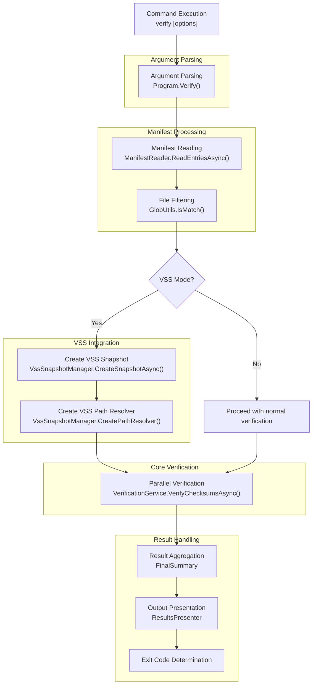
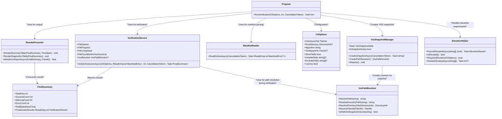
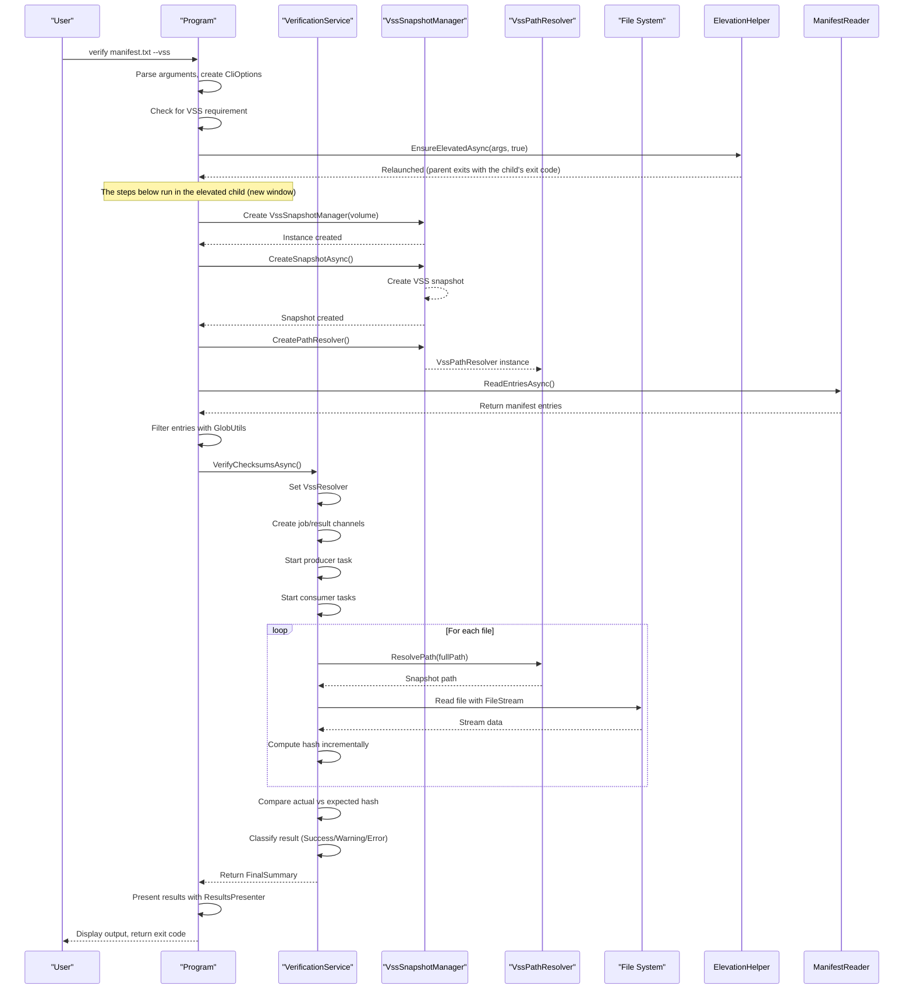
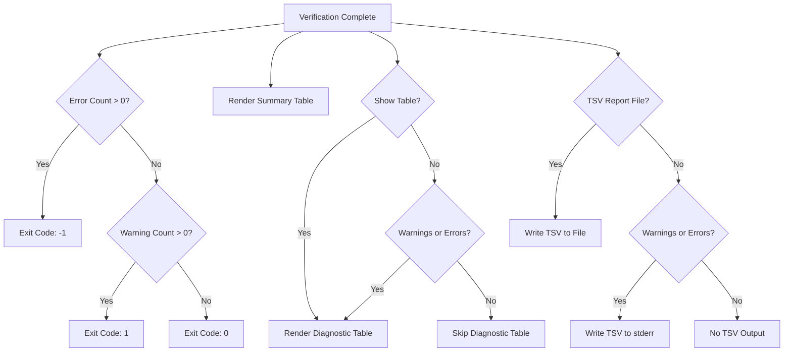
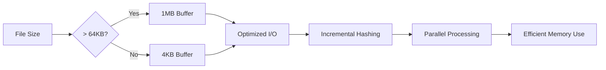

# verify Command


## Update Summary
**Changes Made**   
- Added documentation for the new `--vss` flag that enables Volume Shadow Copy Service support
- Updated command arguments section to include `--vss` parameter and its validation rules
- Enhanced data flow description to include VSS snapshot creation and path resolution
- Added new section on VSS Integration and Elevation Handling
- Updated core components diagram to include new VSS-related classes
- Added VSS-specific error handling and troubleshooting guidance
- Updated real-world usage examples to include VSS scenarios

## Table of Contents
1. [Introduction](#introduction)
2. [Command Arguments and Validation](#command-arguments-and-validation)
3. [Data Flow and Execution Process](#data-flow-and-execution-process)
4. [Core Components and Integration](#core-components-and-integration)
5. [VSS Integration and Elevation Handling](#vss-integration-and-elevation-handling)
6. [Verification Logic and Result Classification](#verification-logic-and-result-classification)
7. [Output and Reporting](#output-and-reporting)
8. [Error Handling and Troubleshooting](#error-handling-and-troubleshooting)
9. [Performance Considerations](#performance-considerations)
10. [Real-World Usage Examples](#real-world-usage-examples)

## Introduction

The `verify` command in Verity is designed to validate the integrity of files against a checksum manifest. It ensures data consistency by computing file hashes and comparing them to expected values stored in a manifest file. This command is essential for verifying backups, detecting unauthorized modifications, and ensuring data reliability in archival systems.

The verification process involves reading a manifest file, computing cryptographic hashes of listed files, and comparing them to stored values. The tool supports multiple hashing algorithms (SHA256, MD5, SHA1) and provides detailed reporting through both terminal output and machine-readable TSV reports. It differentiates between errors (critical failures) and warnings (potential issues), enabling precise automation workflows.

A new feature added to this command is Volume Shadow Copy Service (VSS) support, which allows the tool to access files that are currently locked by other processes by creating a VSS snapshot of the volume. This is particularly useful for verifying system files or files in use by applications.

**Section sources**
- [README.md](../../../README.md)

## Command Arguments and Validation

The `verify` command accepts several arguments that control its behavior, with sensible defaults for ease of use:

**Arguments:**
- `checksumFile`: **Required**. Path to the manifest file containing checksums.
- `--root <directory>`: Root directory for resolving file paths. Defaults to the manifest file's directory.
- `--algorithm <name>`: Hashing algorithm to use (SHA256, MD5, SHA1). Inferred from manifest extension if omitted (.sha256 → SHA256, .md5 → MD5, .sha1 → SHA1, otherwise defaults to SHA256).
- `--threads <number>`: Number of parallel threads. Defaults to processor count.
- `--tsv-report <file>`: Path to write a machine-readable TSV error/warning report.
- `--show-table`: Force display of the diagnostic table even if there are no issues.
- `--include <patterns>`: Semicolon-separated glob patterns for files to include (e.g., `*.txt;*.md`). Defaults to all files.
- `--exclude <patterns>`: Semicolon-separated glob patterns for files to exclude (e.g., `*.tmp;*.bak`). Defaults to none.
- `--vss`: Enable Volume Shadow Copy Service mode to access locked files. Requires administrator privileges.

**Validation Rules:**
- The `checksumFile` must exist and be accessible.
- The specified `--algorithm` must be supported (SHA256, MD5, SHA1).
- The `--threads` value must be positive.
- Glob patterns are validated for syntax during processing.
- File paths are validated for accessibility during verification.
- When `--vss` is specified, the process must be running with elevated privileges or the tool will relaunch itself elevated in a new console window (and exit with that run's exit code; `100` if elevation is declined or fails).

**Section sources**
- [Program.cs](../../../Verity/Program.cs)
- [Models.cs](../../../Verity/Models.cs)
- [README.md](../../../README.md)

## Data Flow and Execution Process

The data flow for the `verify` command follows a structured sequence from argument parsing to final result presentation:



**Diagram sources**
- [Program.cs](../../../Verity/Program.cs)
- [VssSnapshotManager.cs](../../../Verity/Utilities/VssSnapshotManager.cs)
- [VssPathResolver.cs](../../../Verity/Utilities/VssPathResolver.cs)
- [VerificationService.cs](../../../Verity/Services/VerificationService.cs)
- [ResultsPresenter.cs](../../../Verity/Utilities/ResultsPresenter.cs)

**Section sources**
- [Program.cs](../../../Verity/Program.cs)

## Core Components and Integration

The `verify` command integrates several core components to achieve its functionality:




**Diagram sources**
- [Program.cs](../../../Verity/Program.cs)
- [Models.cs](../../../Verity/Models.cs)
- [VerificationService.cs](../../../Verity/Services/VerificationService.cs)
- [ResultsPresenter.cs](../../../Verity/Utilities/ResultsPresenter.cs)
- [ManifestReader.cs](../../../Verity/Utilities/ManifestReader.cs)
- [VssSnapshotManager.cs](../../../Verity/Utilities/VssSnapshotManager.cs)
- [VssPathResolver.cs](../../../Verity/Utilities/VssPathResolver.cs)
- [ElevationHelper.cs](../../../Verity/Utilities/ElevationHelper.cs)

**Section sources**
- [Program.cs](../../../Verity/Program.cs)
- [Models.cs](../../../Verity/Models.cs)

## VSS Integration and Elevation Handling

The `verify` command now supports Volume Shadow Copy Service (VSS) integration, allowing it to verify files that are currently locked by other processes. This feature is particularly useful for system administrators who need to verify the integrity of system files or files in use by applications.

When the `--vss` flag is specified, the following process occurs:

1. **Elevation Check**: `Program.Main` calls `ElevationHelper.EnsureElevatedAsync`. If not elevated, it relaunches the command elevated (UAC) in a new console window, waits for it, and exits with the elevated child's exit code; if elevation is declined or fails, it exits with `100`.

2. **VSS Snapshot Creation**: In the elevated process, the `VssSetup` phase of the run pipeline (`RunPhase`: VssSetup → Header → Prepare → Process → Report → Finished) creates a VSS snapshot of the volume containing the root directory using `VssSnapshotManager.CreateSnapshotAsync()` (default timeout 5 minutes; Ctrl+C interrupts it). This creates a point-in-time copy of the volume that can be accessed even for locked files.

3. **Path Resolution**: The `VssPathResolver` is created to translate original file paths to their corresponding paths within the VSS snapshot. This resolver is then passed to the `VerificationService` for use during file verification.

4. **File Verification**: During verification, the `VerificationService` uses the `VssPathResolver` to read each file from the snapshot. The size tally and the "file not in manifest" scan also enumerate the snapshot (via `RunContext.ScanRoot`), so the whole run sees the same point-in-time view. Reported paths remain the original ones.

5. **Cleanup**: When the pipeline leaves (normally, early or via an exception), the VSS snapshot is automatically cleaned up and resources are released.

The VSS integration requires Windows administrator privileges because creating volume snapshots is a privileged operation. If the tool is not already running with elevation, it will prompt the user for permission and run the verification in a new elevated window.

**Section sources**
- [Program.cs](../../../Verity/Program.cs)
- [VssSnapshotManager.cs](../../../Verity/Utilities/VssSnapshotManager.cs)
- [VssPathResolver.cs](../../../Verity/Utilities/VssPathResolver.cs)
- [ElevationHelper.cs](../../../Verity/Utilities/ElevationHelper.cs)

## Verification Logic and Result Classification

The core verification logic is implemented in the `VerificationService.VerifyChecksumsAsync` method, which uses a producer-consumer pattern for parallel processing:



**Result Classification:**
- **Success**: File exists and hash matches exactly.
- **Warning**: Conditions that may indicate issues but not corruption:
  - Hash mismatch but file is newer than manifest (potential update)
  - Cannot read file due to permission issues
  - File exists but not listed in manifest (unlisted file)
- **Error**: Critical integrity failures:
  - Hash mismatch with older or same-age file (tampering/corruption)
  - File not found when expected to exist

**Section sources**
- [VerificationService.cs](../../../Verity/Services/VerificationService.cs)
- [Models.cs](../../../Verity/Models.cs)

## Output and Reporting

The `verify` command provides comprehensive output through multiple channels:

**Terminal Output:**
- **Header Panel**: Displays verification metadata (timestamp, manifest, algorithm, root directory, filters, and VSS mode if enabled).
- **Progress Bar**: Live progress with file-by-file details during verification.
- **Summary Table**: Post-verification summary showing success/warning/error counts, total files, bytes hashed, time, and throughput.
- **Diagnostic Table**: Detailed report of all non-success results when `--show-table` is specified or issues are found.

**Machine-Readable Output:**
- **TSV Report**: Tab-separated values report written to file (with `--tsv-report`) or stderr (if issues found and no file specified).




**TSV Report Format:**
- **Header**: `#Status\tFile\tDetails\tExpectedHash\tActualHash`
- **Columns**:
  - `Status`: ERROR or WARNING
  - `File`: Relative path to the file
  - `Details`: Description of the issue
  - `ExpectedHash`: Expected hash from manifest
  - `ActualHash`: Computed hash of the file

**Section sources**
- [ResultsPresenter.cs](../../../Verity/Utilities/ResultsPresenter.cs)
- [Program.cs](../../../Verity/Program.cs)

## Error Handling and Troubleshooting

The `verify` command implements robust error handling with clear classification:

**Common Issues and Solutions:**

| Issue | Classification | Cause | Troubleshooting |
|------|---------------|------|----------------|
| **File Not Found** | Error | File listed in manifest doesn't exist | Verify file paths, check for accidental deletion, ensure correct root directory |
| **Hash Mismatch (Older File)** | Error | File content differs from manifest and file is not newer | Investigate potential tampering, corruption, or incomplete transfer |
| **Hash Mismatch (Newer File)** | Warning | File content differs but file modification time is after manifest creation | Expected when files have been legitimately updated; consider recreating manifest |
| **Cannot Read File** | Warning | Permission denied, locked file, or I/O error | Check file permissions, ensure no other process is using the file |
| **Unlisted File** | Warning | File exists in directory but not in manifest | Expected for new files; use `add` command to include them in manifest |
| **VSS Elevation Required** | Error | VSS mode requested but process not running with administrator privileges | Run the tool as administrator or allow elevation prompt |
| **VSS Snapshot Creation Failed** | Error | Failed to create VSS snapshot due to system limitations | Verify VSS service is running, check disk space, ensure volume supports snapshots |
| **Volume Not Supported for VSS** | Error | The volume does not support VSS snapshots | VSS is not available on some volume types (e.g., network drives, certain file systems) |

**Exit Codes:**
- `0`: Success (all files verified, no warnings)
- `1`: Warning (verification completed with warnings, no errors)
- `-1`: Error (verification failed due to errors)
- `-2`: Canceled by user (manual interruption)
- `100`: VSS Elevation Required (`--vss` without admin rights and the UAC prompt was declined or the relaunch failed; after a successful relaunch the exit code is the elevated child's)
- `101`: VSS Not Available (reserved; not currently returned)
- `102`: VSS Snapshot Creation Failed (failed or timed out)
- `103`: Volume Not Supported for VSS (volume root could not be determined)

**Section sources**
- [VerificationService.cs](../../../Verity/Services/VerificationService.cs)
- [VssSnapshotManager.cs](../../../Verity/Utilities/VssSnapshotManager.cs)
- [ElevationHelper.cs](../../../Verity/Utilities/ElevationHelper.cs)
- [VerifyCommandTests.cs](../../../Verity.Tests/IntegrationTests/VerifyCommandTests.cs)

## Performance Considerations

The `verify` command is optimized for high performance through several mechanisms:

**Parallel Processing:**
- Uses a producer-consumer pattern with `Channel<T>` for efficient work distribution.
- Default parallelism equals processor count, saturating CPU cores.
- Configurable via `--threads` parameter for resource-constrained environments.

**I/O Optimization:**
- Dynamically adjusts buffer sizes based on file size:
  - **Small files** (< 64KB): 4KB buffer
  - **Large files** (≥ 64KB): 1MB buffer
- Uses asynchronous file I/O with `FileStream` and `ArrayPool<byte>` for memory efficiency.
- Implements incremental hashing to avoid loading entire files into memory.

**Resource Management:**
- Processes files incrementally without loading all manifest entries into memory simultaneously.
- Uses bounded channels to prevent memory exhaustion.
- Employs `ArrayPool<byte>` to minimize garbage collection pressure.

**VSS Performance Considerations:**
- VSS snapshot creation adds overhead but enables access to locked files.
- The snapshot is created once and reused for all file accesses during verification.
- VSS path resolution is lightweight and does not impact verification performance significantly.



**Section sources**
- [FileIOUtils.cs](../../../Verity/Utilities/FileIOUtils.cs)
- [VerificationService.cs](../../../Verity/Services/VerificationService.cs)

## Real-World Usage Examples

**Basic Verification:**
```
bash
Verity.exe verify C:\backups\manifest.sha256

```
Verifies all files in the manifest using the directory of the manifest as the root.

**Verification with Custom Root:**
```
bash
Verity.exe verify D:\archive\manifest.md5 --root E:\data\current

```
Uses a different root directory for file resolution, useful when verifying backups against current data.

**Filtered Verification with Reporting:**
```
bash
Verity.exe verify C:\project\manifest.txt --include "*.dll;*.exe" --exclude "*.pdb" --tsv-report issues.tsv

```
Verifies only DLL and EXE files, excluding PDB files, and writes any issues to a TSV report.

**Verification with VSS Support:**
```
bash
Verity.exe verify C:\system\manifest.sha256 --vss --root C:\Windows\System32

```
Verifies system files including those currently locked by processes, using VSS snapshot technology. Requires administrator privileges.

**Automation Scripting:**
```
powershell
$result = .\Verity.exe verify .\manifest.sha256
if ($result -eq 0) {
    Write-Host "Verification succeeded"
} elseif ($result -eq 1) {
    Write-Host "Verification completed with warnings"
} elseif ($result -eq -1) {
    Write-Error "Verification failed with errors"
} elseif ($result -eq 100) {
    Write-Host "VSS mode requires elevation - please run as administrator"
}
```
Uses exit codes for automated decision-making in scripts, including handling VSS-specific error codes.

**Section sources**
- [README.md](../../../README.md)
- [VerifyCommandTests.cs](../../../Verity.Tests/IntegrationTests/VerifyCommandTests.cs)

**Referenced Files in This Document**   
- [Program.cs](../../../Verity/Program.cs) - *Updated to support VSS functionality*
- [Models.cs](../../../Verity/Models.cs) - *Updated with UseVss property in CliOptions*
- [VerificationService.cs](../../../Verity/Services/VerificationService.cs) - *Integrated VssResolver for VSS path resolution*
- [ResultsPresenter.cs](../../../Verity/Utilities/ResultsPresenter.cs) - *No changes required*
- [ManifestReader.cs](../../../Verity/Utilities/ManifestReader.cs) - *No changes required*
- [FileIOUtils.cs](../../../Verity/Utilities/FileIOUtils.cs) - *No changes required*
- [GlobUtils.cs](../../../Verity/Utilities/GlobUtils.cs) - *No changes required*
- [VerifyCommandTests.cs](../../../Verity.Tests/IntegrationTests/VerifyCommandTests.cs) - *Updated with VSS-related test cases*
- [README.md](../../../README.md) - *Updated with VSS flag documentation*
- [VssPathResolver.cs](../../../Verity/Utilities/VssPathResolver.cs) - *New component for VSS path resolution*
- [VssSnapshotManager.cs](../../../Verity/Utilities/VssSnapshotManager.cs) - *New component for managing VSS snapshots*
- [ElevationHelper.cs](../../../Verity/Utilities/ElevationHelper.cs) - *New utility for handling elevation requirements*